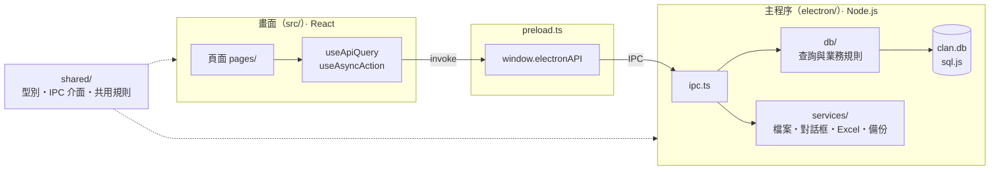
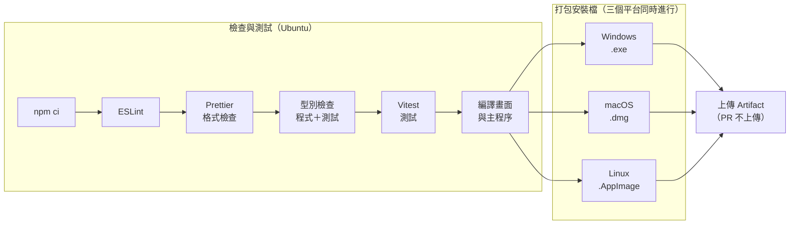

<div align="center">

# 傅氏宗親會管理系統

**宗親名冊・世系圖・活動行事曆・會費與收支，一套桌面程式全部搞定**

[](https://github.com/AnthonyFuFu/fu-clan-management-system/actions/workflows/ci.yml)


<br />


[功能特色](#-功能特色) ・
[快速開始](#-快速開始) ・
[常用指令](#-常用指令) ・
[架構](#-架構) ・
[開發慣例](#-開發慣例) ・
[資料與備份](#-資料儲存與備份) ・
[打包與安裝](#-打包與安裝) ・
[CI](#-持續整合ci)

</div>

---

以 [Electron](https://www.electronjs.org/) + [Vite](https://vite.dev/) 打造的桌面應用程式，畫面使用 React + TypeScript + Ant Design，資料存在本機的 SQLite（[sql.js](https://sql.js.org/)，WebAssembly 版，不需要原生編譯）。**資料完全留在使用者自己的電腦裡**，不需要網路，也不需要架設伺服器。

## ✨ 功能特色

| | 功能 | 說明 |
|:---:|---|---|
| 🏠 | **首頁儀表板** | 宗親人數、近期活動與壽辰、會費收繳進度、本年度收支、世代／分支／年齡分布，以及待處理事項提醒 |
| 👥 | **宗親成員管理** | 分頁列表、依姓名／電話搜尋、依世代／性別／在世與否篩選；新增子女時自動推算世代；可從 Excel 匯入名冊 |
| 🌳 | **宗親世系圖** | 以任一位宗親為中心，顯示上下三代與旁系親屬，點選節點即可切換中心人物 |
| 📅 | **活動與聚會** | 月曆檢視、近期行程，開啟程式時自動提醒即將到來的活動（提醒天數可設定） |
| 💰 | **財務管理** | 年度會費名單（已繳／未繳／免繳、批次登記繳費）、收支明細、年度總覽與收支構成，可匯出 Excel |
| 📁 | **文件檔案** | 上傳、開啟、下載會議紀錄等文件；Excel 匯入／匯出集中入口 |
| ⚙️ | **系統設定** | 文字大小（方便年長者閱讀）、活動提醒天數、**備份與還原** |

<details>
<summary><b>🛡️ 資料安全設計</b></summary>

<br />

- **原子存檔**：先寫到暫存檔再取代原檔，存到一半停電或當機，資料庫仍然完好
- **每天自動備份**：每天第一次開啟時自動備份，保留最近 14 天
- **手動備份與還原**：可備份到隨身碟或雲端硬碟資料夾；還原前會自動保留一份目前的資料
- **升級不刪資料**：資料表結構變更一律保留既有資料，必要時先快照
- **外鍵檢查**：資料之間的關聯由資料庫把關，不會出現指向不存在成員的紀錄
- **記錄檔**：主程序的錯誤寫入 `logs/main.log`，方便追查問題

</details>

## 🚀 快速開始

### 環境需求

| 工具 | 版本 | 備註 |
|---|---|---|
| Node.js | **22.13+ 的 22.x、24.x 或 26+** | 建議使用 LTS 24。專案的 `.nvmrc` 指定 24，用 nvm 時執行 `nvm use` 即可。Node 20 與 23 無法使用（Vitest 5、jsdom 29、concurrently 10 的共同需求） |
| npm | 10+ | |

### 安裝與啟動

```bash
# 1. 安裝套件
npm install

# 2. 啟動開發環境（Electron 視窗 + 熱重載，會自動開啟開發者工具）
npm run electron:dev
```

- 修改 `src/` 底下的畫面程式：存檔後畫面會自動更新。
- 修改 `electron/` 底下的主程序：要按 `Ctrl+C` 停止後重新執行指令才會生效。
- 開發模式會自動建立**範例資料**（34 位宗親、範例活動與帳目）；正式安裝則從空白資料庫開始。

> [!NOTE]
> 安裝時會看到 `inflight`、`glob@7`、`rimraf@2` 的 deprecated 警告，這些來自 electron-builder 內部，只在打包時使用，可以忽略。
> `package.json` 的 `overrides` 強制使用 `global-agent` 4，用來排除 electron-builder 依賴中 `sprintf-js` 的安全性警告，請勿移除。

<details>
<summary><b>只開瀏覽器做畫面開發（不開 Electron 視窗）</b></summary>

<br />

```bash
npm start
```

開啟 <http://127.0.0.1:3000> 預覽。

> [!WARNING]
> 純瀏覽器模式不會執行 Electron 主程序，讀不到 SQLite 資料（`window.electronAPI` 不存在），每個頁面都會顯示「請以桌面版開啟」的提示，只適合調整版面。

</details>

## 🧰 常用指令

**開發**

| 指令 | 說明 |
|---|---|
| `npm run electron:dev` | 同時啟動 Vite 開發伺服器與 Electron 視窗，畫面支援熱重載 |
| `npm start` | 只啟動 Vite 開發伺服器（純瀏覽器） |
| `npm run electron` | 編譯主程序後以 Electron 開啟已編譯的 `build/`，等同正式版行為（需先 `npm run build`） |

**品質檢查**（提交前建議全部執行，CI 也會檢查）

| 指令 | 說明 |
|---|---|
| `npx vitest run` | 執行一次所有測試 |
| `npm test` | 以 watch 模式執行測試，存檔自動重跑（按 `q` 離開） |
| `npm run lint` | 以 ESLint 檢查程式寫法 |
| `npm run format` | 以 Prettier 統一程式格式（`npm run format:check` 只檢查不修改） |
| `npx tsc --noEmit -p tests` | 型別檢查測試檔（Vitest 執行時不做型別檢查） |

**建置與打包**

| 指令 | 說明 |
|---|---|
| `npm run build` | 型別檢查並編譯畫面到 `build/` |
| `npm run build:electron` | 編譯主程序到 `dist-electron/` |
| `npm run electron:build` | 完整打包成安裝程式（見[打包與安裝](#-打包與安裝)） |
| `npm run preview` | 在瀏覽器預覽 `build/` 的編譯結果 |
| `npm run icons` | 修改 `src/assets/icon.svg` 後，重新產生各平台的應用程式圖示 |

## 🏗️ 架構



- **畫面只能透過 `window.electronAPI` 存取資料。** `contextIsolation` 開啟、`nodeIntegration` 關閉，正式版另有 Content-Security-Policy。
- **IPC 有型別保護。** [`shared/ipc.ts`](shared/ipc.ts) 的 `ElectronAPI` 介面同時約束 `electron/ipc.ts` 與 `electron/preload.ts`，兩邊名稱或參數對不上時編譯就會失敗。
- **寫入後立即存檔。** 寫入類的 IPC 以 `handleWrite` 註冊，完成後自動存檔。
- 前端使用 `HashRouter`，因為正式版以 `file://` 載入，`BrowserRouter` 會找不到路由。

| 分類 | 工具 |
|---|---|
| 畫面 | React 19、TypeScript、Ant Design 6、react-router-dom、dayjs |
| 狀態管理 | React Context（`src/providers/`） |
| 桌面與打包 | Electron、electron-builder |
| 資料 | SQLite（sql.js）、Excel 匯入匯出（SheetJS xlsx） |
| 建置與測試 | Vite、Vitest、Testing Library |
| 程式品質 | ESLint、Prettier、GitHub Actions |

<details>
<summary><b>📂 專案結構</b></summary>

```
├── shared/                    # 主程序與畫面共用（兩邊都 import 這裡，不要各寫一份）
│   ├── types/                 # 資料型別，依功能分檔，一律從 shared/types 匯入
│   ├── ipc.ts                 # window.electronAPI 介面；方法名稱就是 IPC channel 名稱
│   ├── events.ts              # 活動提醒規則（提醒天數內、今天已結束不提醒）
│   ├── settings.ts            # 系統設定的選項與預設值（文字大小、提醒天數）
│   ├── finance.ts             # 財務規則常數（預設會費、收支類別）
│   ├── labels.ts              # 畫面與 Excel 共用的顯示文字（性別…）
│   └── errors.ts              # 錯誤訊息整理（去掉 IPC 加上的前綴）
│
├── electron/                  # 主程序（Node.js 環境）
│   ├── main.ts                # 進入點：開啟資料庫、自動備份、建立視窗
│   ├── ipc.ts                 # 註冊所有 IPC handler（錯誤會寫進記錄檔）
│   ├── preload.ts             # contextBridge 暴露 window.electronAPI（沙箱環境，只能 import type）
│   ├── services/              # 需要檔案系統或系統對話框的功能
│   │   ├── backup.ts          # 手動備份、還原、每天自動備份
│   │   ├── documents.ts       # 文件上傳、下載、開啟、刪除
│   │   ├── dialogs.ts         # 開啟／儲存檔案、選擇資料夾的對話框
│   │   ├── logger.ts          # 主程序記錄檔（logs/main.log）
│   │   └── excel/             # Excel 匯入匯出流程；產生與解析 Excel 的部分不碰對話框，可單獨測試
│   └── db/                    # SQLite 資料庫
│       ├── index.ts           # initDatabase 與對外匯出的查詢函式
│       ├── connection.ts      # 連線、原子存檔、快照、查詢與交易工具（開啟外鍵檢查）
│       ├── schema.ts          # 資料表結構與版本升級（升級一律保留既有資料）
│       ├── validation.ts      # 寫入前共用的格式檢查
│       ├── seed.ts            # 範例資料（只在開發模式與測試中建立）
│       ├── members.ts         # 成員名單、新增／修改／刪除、搜尋
│       ├── familyTree.ts      # 世系圖
│       ├── events.ts          # 活動與聚會
│       ├── finance.ts         # 會費名單、收支明細、統計
│       ├── documents.ts       # 上傳文件的中繼資料
│       ├── settings.ts        # 系統設定（存在 meta 資料表）
│       └── dashboard.ts       # 首頁儀表板統計
│
├── src/                       # 畫面（React）
│   ├── App.tsx                # 路由（純瀏覽器模式由 DesktopOnly 統一顯示提示）
│   ├── pages/                 # 每個功能頁面一個資料夾：index.tsx + components/ + constants.ts
│   │   ├── Dashboard/  Members/  FamilyTree/  Events/
│   │   └── Finance/  Documents/  Settings/
│   ├── components/            # 跨頁面共用元件（MainLayout、EventReminder、MemberSelect、MemberImport、DesktopOnly）
│   ├── providers/             # 全系統共用狀態（SettingsProvider、UpcomingEventsProvider）
│   ├── hooks/                 # useApiQuery（讀取）、useAsyncAction（寫入並提示結果）、useElectronAPI
│   ├── hoc/                   # remountOnOpen：對話框每次開啟都用全新表單
│   ├── constants/             # 全系統共用常數（語意色、天數標籤色）
│   ├── utils/                 # 共用純函式（金額、日期格式）
│   ├── types/                 # 全域型別宣告（window.electronAPI）
│   └── assets/                # 應用程式圖示：icon.svg 為原始檔，其餘由 npm run icons 產生
│
├── tests/                     # 所有測試（Vitest）
│   ├── helpers/               # 假的 window.electronAPI、render 工具、資料庫測試工具
│   ├── electron/              # 資料庫與主程序服務測試（Node 環境，使用暫存資料夾）
│   ├── pages/  components/  hooks/  shared/
│   └── setup.ts
│
├── vite.config.mts            # Vite／Vitest 設定（路徑別名、正式版 CSP）
├── eslint.config.mjs          # ESLint 設定（程式寫法）
├── .prettierrc.json           # Prettier 設定（程式格式）
├── tsconfig.json              # 畫面（src/、shared/）的 TypeScript 設定
├── tsconfig.electron.json     # 主程序（electron/、shared/）的 TypeScript 設定
├── scripts/generate-icons.js  # 由 icon.svg 產生 icon.png／.ico／.icns
└── electron-builder.config.js # 打包設定（不能命名為 electron-builder.js：Windows 會把它當成指令執行）
```

以下資料夾由指令產生，已加入 `.gitignore`：

| 資料夾 | 產生方式 | 內容 |
|---|---|---|
| `build/` | `npm run build` | 編譯後的畫面 |
| `dist-electron/` | `npm run build:electron` | 編譯後的主程序 |
| `dist/` | `npm run electron:build` | 打包好的安裝檔 |

</details>

## 📐 開發慣例

**放哪裡**

1. 新頁面放在 `src/pages/<功能名稱>/`，進入點為 `index.tsx`；只有這頁用到的元件放在它的 `components/`，常數放 `constants.ts`。
2. 兩個以上頁面都會用到的東西，才放到 `src/components/`、`src/hooks/`、`src/utils/`、`src/constants/`。**頁面之間不要互相 import**，要共用就先搬到這些資料夾。
3. 引用共用程式時使用路徑別名：`@/` 代表 `src/`，`@shared/` 代表 `shared/`。主程序（`electron/`）不支援別名，請用相對路徑。

**怎麼寫**

4. 頁面一律用 `useElectronAPI()` 取得 API，不用自己檢查純瀏覽器模式。
5. 讀取資料用 `useApiQuery((api) => api.xxx(...), [依賴])`，它會處理 loading、錯誤訊息與過期的回應；寫入用 `useAsyncAction`。**不要直接寫 `api.xxx().then(...)`。**
6. 含表單的對話框用 `export default remountOnOpen(MyModal, (props) => props.open)` 匯出，否則上一次輸入的內容會殘留到下一次開啟。
7. 可以點的區塊一律用 `<button>`、`<Link>` 等可以用鍵盤操作的元素，不要在 `div` 上加 `onClick`（需要時用 `plain-button` 樣式去掉按鈕外觀）。
8. 註解一律用中文，寫「為什麼」而不是「做什麼」。提交前執行 `npm run lint` 與 `npm run format`。

**新增一個讀寫資料庫的功能**

9. 依序完成以下四步，漏了任何一步 TypeScript 編譯時就會報錯：
   1. 在 `shared/types/` 加資料型別、在 `shared/ipc.ts` 的 `ElectronAPI` 加方法
   2. 在 `electron/db/` 實作查詢，並從 `electron/db/index.ts` 匯出
   3. 在 `electron/ipc.ts` 註冊 handler（寫入類用 `handleWrite`，會自動存檔）
   4. 在 `electron/preload.ts` 補上對應方法

> [!CAUTION]
> **修改資料表結構時絕對不能刪除使用者資料。** 新增欄位用 `ALTER TABLE`（參考 `schema.ts` 的 `migrate*Columns`）；真的需要重建資料表時，先呼叫 `snapshotDatabase()` 留下副本，再把舊資料搬到新表。

## 💾 資料儲存與備份

資料存在 Electron 的使用者資料夾（不在專案資料夾內）：

| 作業系統 | 位置 |
|---|---|
| Windows | `%APPDATA%\fu-clan-management-system\` |
| macOS | `~/Library/Application Support/fu-clan-management-system/` |
| Linux | `~/.config/fu-clan-management-system/` |

```
fu-clan-management-system/
├── clan.db              # 資料庫：宗親、活動、財務、系統設定
├── documents/           # 上傳的文件（檔名是系統產生的亂碼，原始檔名記在資料庫中）
├── backups/             # 每天的自動備份 auto-YYYY-MM-DD.db（保留 14 天），以及還原、升級前留下的副本
└── logs/main.log        # 主程序記錄檔：使用者回報問題時，請對方提供這個檔案
```

- **備份與還原**：在「系統設定 → 備份與還原」可以備份到隨身碟或雲端硬碟資料夾（內容為 `clan.db` + `documents/`），也可以從備份還原。
- **資料庫打不開時**：程式會顯示錯誤訊息與資料位置，可以把 `backups/` 裡最近一份自動備份改名為 `clan.db`，取代原本的檔案。
- **查看資料**：可以用 [DB Browser for SQLite](https://sqlitebrowser.org/) 或 VS Code 的 SQLite 擴充套件開啟 `clan.db`。

## 📦 打包與安裝

```bash
npm run electron:build
```

依序執行 `npm run build` → `npm run build:electron` → `electron-builder`（設定見 [electron-builder.config.js](electron-builder.config.js)），安裝檔輸出到 **`dist/`**。

| 平台 | 產物 | 安裝方式 |
|---|---|---|
| Windows | `.exe`（NSIS） | 雙擊執行，跟著安裝精靈完成，桌面與開始選單會有捷徑 |
| macOS | `.dmg` | 開啟後把 App 拖曳到「應用程式」資料夾 |
| Linux | `.AppImage` | `chmod +x <檔名>.AppImage` 後直接執行 |

安裝檔已包含完整的執行環境，**使用者端不需要安裝 Node.js** 或任何開發工具。

> [!IMPORTANT]
> - electron-builder 只能可靠地打包目前作業系統對應的格式（例如 `.dmg` 要在 macOS 上產生）。跨平台打包請參考[官方文件](https://www.electron.build/multi-platform-build)，或直接使用 CI 產出的安裝檔。
> - **macOS**：目前沒有設定公證（notarization），其他 Mac 第一次開啟時可能出現「無法驗證開發者」，請在 Finder 對 App 按右鍵 →「打開」。正式散布需要 Apple Developer ID，見[簽章文件](https://www.electron.build/code-signing-mac)。
> - **Windows**：安裝程式沒有程式碼簽章，SmartScreen 可能顯示警告，點「其他資訊」→「仍要執行」即可。

<details>
<summary><b>只想確認打包後能否執行（不產生安裝檔）</b></summary>

<br />

```bash
npm run build && npm run build:electron
npx electron-builder --config electron-builder.config.js --dir
```

macOS 的產物在 `dist/mac-arm64/`。

</details>

## 🔄 持續整合（CI）

設定檔：[.github/workflows/ci.yml](.github/workflows/ci.yml)。README 最上方的 CI 徽章會顯示 `master` 最近一次執行的結果，點下去可以看到每次執行的紀錄。

### 什麼時候執行

| 觸發條件 | 檢查與測試 | 打包安裝檔 | 保存安裝檔 |
|---|:---:|:---:|:---:|
| push 到 `master` | ✅ | ✅ | ✅ 保留 30 天 |
| 對 `master` 開 PR | ✅ | ✅ | — 只驗證能打包 |
| 在 GitHub Actions 頁面按「Run workflow」手動執行 | ✅ | ✅ | ✅ 保留 30 天 |

### 流程



| 工作 | 執行環境 | 步驟 |
|---|---|---|
| **檢查與測試** | Ubuntu | `npm ci` → `npm run lint` → `npm run format:check` → `tsc --noEmit`（程式）→ `tsc --noEmit -p tests`（測試）→ `vitest run` → `npm run build` → `npm run build:electron` |
| **打包安裝檔** | Windows、macOS、Ubuntu | 檢查與測試通過後才開始：`npm ci` → 編譯畫面與主程序 → `electron-builder --publish never` → 上傳安裝檔 |

任何一個步驟失敗，該次執行就會標示為失敗；「檢查與測試」沒過時不會進行打包。

### 下載安裝檔

1. 到 GitHub 專案的 **Actions** 分頁，點選 `master` 上最近一次成功（綠色勾勾）的執行。
2. 捲到頁面最下方的 **Artifacts**，依平台下載：
   - `傅氏宗親會管理系統-Windows`（`.exe`）
   - `傅氏宗親會管理系統-macOS`（`.dmg`）
   - `傅氏宗親會管理系統-Linux`（`.AppImage`）
3. 下載的是 zip 壓縮檔，解壓縮後就是安裝檔。

> [!NOTE]
> CI 上沒有 Apple 與 Windows 的簽章憑證，產出的安裝檔都**沒有簽章**：macOS 第一次開啟需要在 Finder 對 App 按右鍵 →「打開」；Windows 遇到 SmartScreen 警告時點「其他資訊」→「仍要執行」。

<details>
<summary><b>CI 設定的細節與原因</b></summary>

<br />

| 設定 | 原因 |
|---|---|
| `concurrency` + `cancel-in-progress` | 同一個分支或 PR 有新的 push 時，取消還在跑的舊流程，節省時間 |
| `permissions: contents: read` | 流程只需要讀取程式碼，權限給到最小 |
| 所有平台都用 `bash` | Windows 預設的 PowerShell 不一定會把指令失敗傳回給步驟，曾經發生打包失敗卻顯示成功 |
| 檢查與測試設定 `ELECTRON_SKIP_BINARY_DOWNLOAD` | 測試與編譯不需要 Electron 執行檔，跳過下載可以加快速度 |
| 打包使用 `fail-fast: false` | 某個平台打包失敗時，其他平台仍然繼續，一次就能看出所有問題 |
| 打包設定 `CSC_IDENTITY_AUTO_DISCOVERY: false` | CI 上沒有簽章憑證，明確指定不簽章，避免 electron-builder 嘗試尋找憑證而失敗 |
| 上傳設定 `if-no-files-found: error` | 打包步驟如果沒有真的產出安裝檔，就讓流程失敗，而不是上傳空的 Artifact |
| Node.js 版本讀取 `.nvmrc` | CI 與本機開發使用同一個 Node.js 版本 |

</details>

## 🩺 疑難排解

<details>
<summary><code>TypeError: Cannot read properties of undefined (reading 'whenReady')</code></summary>

<br />

環境變數 `ELECTRON_RUN_AS_NODE=1` 讓 Electron 以純 Node 模式執行，某些在 VS Code 擴充功能內開啟的終端機會繼承這個變數。先清除再執行：

```bash
unset ELECTRON_RUN_AS_NODE            # macOS / Linux
```

```powershell
Remove-Item Env:ELECTRON_RUN_AS_NODE  # Windows PowerShell
```

</details>

<details>
<summary><code>npm error Exit handler never called!</code>、<code>tsc: command not found</code>、<code>electron: command not found</code></summary>

<br />

npm 安裝中途中斷，`node_modules` 不完整。刪除後重裝：

```bash
rm -rf node_modules
npm install
```

仍然失敗時，可以先執行 `npm cache clean --force`，或改用 npm 10（`npm i -g npm@10`）。

</details>

<details>
<summary><code>Error: Port 3000 is already in use</code></summary>

<br />

Vite 固定使用 port 3000（Electron 要連到這個位址），請先關閉佔用的程式。macOS／Linux 可以用 `lsof -i :3000` 找出是哪個程式。

</details>

<details>
<summary><code>npm warn EBADENGINE Unsupported engine</code></summary>

<br />

Node.js 版本不符合[環境需求](#環境需求)，請升級 Node.js。

</details>

## 📝 開發歷程備忘

專案原本以 Create React App 建立，之後遷移到 Vite（`react-scripts` 已移除）。以下記錄安裝過的套件，僅供參考；正常開發直接執行 `npm install` 即可。

<details>
<summary><b>套件安裝指令</b></summary>

<br />

```bash
# React + UI 元件庫
npm install react react-dom antd @ant-design/icons

# 路由
npm install react-router-dom

# 工具函式庫
npm install dayjs

# SQLite（WebAssembly 版，無需原生編譯）
npm install sql.js

# 建置工具與測試（Vite / Vitest）
npm install --save-dev vite @vitejs/plugin-react vitest jsdom@29
npm install --save-dev @testing-library/react @testing-library/dom @testing-library/jest-dom @testing-library/user-event

# Electron 與打包
npm install --save-dev electron electron-builder concurrently wait-on cross-env

# TypeScript 與型別定義
npm install --save-dev typescript@5 @types/node @types/react @types/react-dom @types/sql.js

# 程式寫法與格式檢查
npm install --save-dev eslint @eslint/js typescript-eslint eslint-plugin-react-hooks eslint-config-prettier prettier globals
```

> - `jsdom` 固定在 29 版：30 版需要 Node.js 24.15 以上。
> - `typescript` 固定在 5.x：7.x 是以 Go 重寫的新版編譯器，周邊工具尚未完全支援。

</details>
